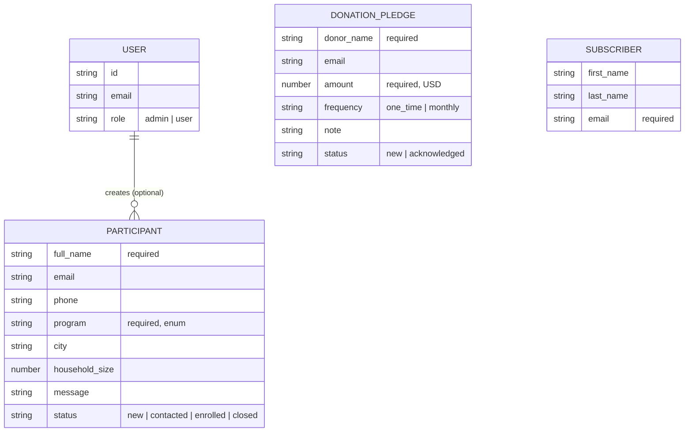

# Database Design

The Investors Academy platform runs on four entities. Every record automatically carries `id`, `created_date`, `updated_date` and `created_by_id`.

## Entity relationship overview

## Participant

A request for help submitted through the Get Help page.

| Field | Type | Required | Notes |
| --- | --- | --- | --- |
| full_name | string | yes | Person requesting support |
| email | string (email) | | |
| phone | string | | |
| program | enum | yes | `housing`, `youth_outreach`, `workforce`, `food_pantry`, `clothing_closet`, `other` |
| city | string | | |
| household_size | number | | |
| message | string | | What the person is facing and what they need |
| status | enum | | `new` (default), `contacted`, `enrolled`, `closed` |

**Request pipeline:** `new → contacted → enrolled → closed`. Staff move requests through the pipeline from the admin dashboard with inline status updates.

## DonationPledge

A gift pledge submitted through the Donate page.

| Field | Type | Required | Notes |
| --- | --- | --- | --- |
| donor_name | string | yes | |
| email | string (email) | | |
| amount | number | yes | Pledged gift in USD |
| frequency | enum | | `one_time` (default), `monthly` |
| note | string | | |
| status | enum | | `new` (default), `acknowledged` |

The dashboard aggregates pledges by `frequency` and sums `amount` for the Total Pledged stat.

## Subscriber

A newsletter signup.

| Field | Type | Required |
| --- | --- | --- |
| first_name | string | |
| last_name | string | |
| email | string (email) | yes |

## User

Built in account entity extended with a `role` field (`admin` or `user`, required).

## Access rules (row level security)

| Entity | Create | Read | Update | Delete |
| --- | --- | --- | --- | --- |
| Participant | anyone | record creator or admin | admin | admin |
| DonationPledge | anyone | admin | admin | admin |
| Subscriber | anyone | admin | admin | admin |

Public forms can write but never read back other people's data. Every dashboard query is enforced by these rules on the server, not just hidden in the UI.

## Dashboard queries

| Stat or view | Query |
| --- | --- |
| New requests | `Participant.count({ status: "new" })` |
| Total requests | `Participant.count({})` |
| Subscribers | `Subscriber.count({})` |
| Total pledged | `DonationPledge.aggregate({ groupBy: "frequency", sum: ["amount"] })` |
| Request, subscriber and pledge tables | latest 100 of each, sorted by `-created_date` |

Schema source: [`base44/entities/`](../base44/entities)
